# Linux Firewall Migration Lab
### Migrating iptables to nftables on Debian and Ubuntu Linux Servers

**XP Cyber Range | October 26, 2026 | Full Check Pass: 6/6**

## Project Overview

In this XP Cyber Range challenge, I was tasked with migrating two Linux servers from the legacy `iptables` firewall utility to `nftables` without disrupting their existing network services. The environment included a Prod-Joomla web server running an older Debian-based Linux system and a Fileshare server running Ubuntu 24.04.3 LTS. Both servers had different firewall requirements, so I needed to review their existing rules before making any changes.

My objective was to recreate the original filtering policies using `nftables`, remove the old `iptables` packages, and make sure the new firewall services were enabled and filtering traffic correctly. The Prod-Joomla server also required an additional rule to allow HTTPS traffic on TCP port 443. I completed the migration on both servers and passed all six validation checks.

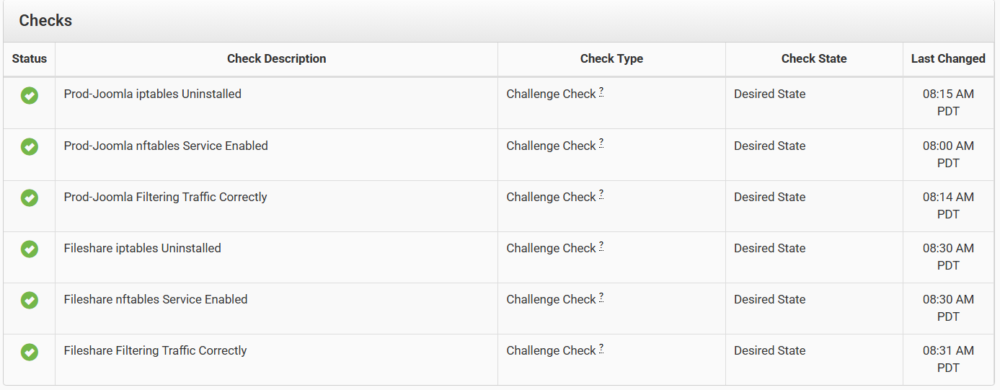

## Lab Environment and Tools

The challenge took place in a simulated enterprise network with a screened subnet, production network, and userspace subnet. Prod-Joomla was located on the `172.16.10.0/24` screened subnet, while Fileshare was located on the `172.16.30.0/24` production network.

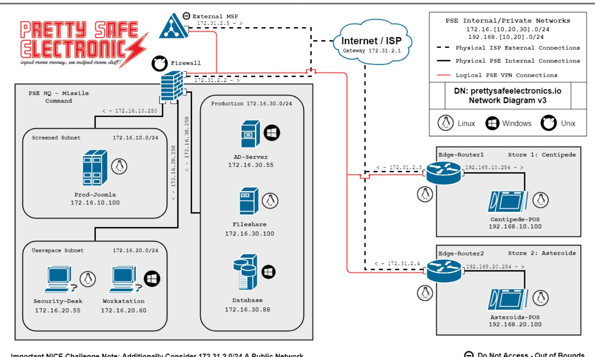

I worked directly in the Linux terminal using `iptables`, `nftables`, `systemctl`, `apt`, `dpkg`, and GNU Nano. Unlike some of my previous firewall labs that used graphical interfaces, this challenge required me to configure and troubleshoot the firewall rules through the command line.

## Prod-Joomla Firewall Migration

I started by locating and reviewing the saved `iptables` rules on Prod-Joomla using `cat ProdWeb_iptables_v4`. The original configuration had an INPUT policy of DROP, while FORWARD and OUTPUT were set to ACCEPT. It also allowed established and related connections, SSH on TCP port 22, and HTTP on TCP port 80. These rules gave me a starting point for creating the new configuration without accidentally blocking services the server needed.

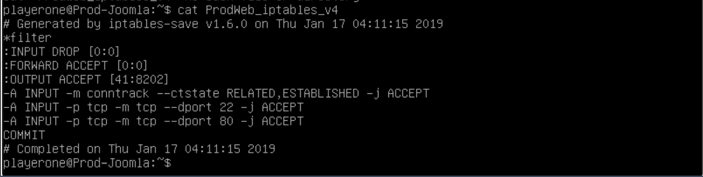

I then edited `/etc/nftables.conf` using GNU Nano and created an `inet` filter table containing the input, forward, and output chains. I kept the original policies and allowed connections, but added TCP port 443 for HTTPS as required by the challenge.

| Chain | Policy | Allowed Incoming Traffic |
|---|---|---|
| INPUT | DROP | Established/related, TCP 22, 80, 443 |
| FORWARD | ACCEPT | All forwarded traffic |
| OUTPUT | ACCEPT | All outbound traffic |

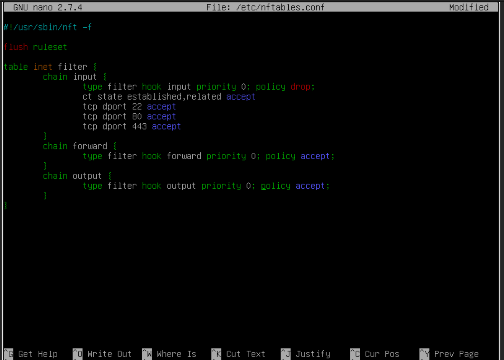

After saving the configuration, I attempted to check its syntax using `sudo nft -c -f /etc/nftables.conf`, but the command returned an invalid option error. I checked the installed version and found that Prod-Joomla was running `nftables v0.7`, which did not support that option. I used `sudo nft --help` to review the available commands, then loaded the configuration with `sudo nft -f /etc/nftables.conf`. Running `sudo nft list table inet filter` confirmed that the rules had been applied, including the new HTTPS rule.

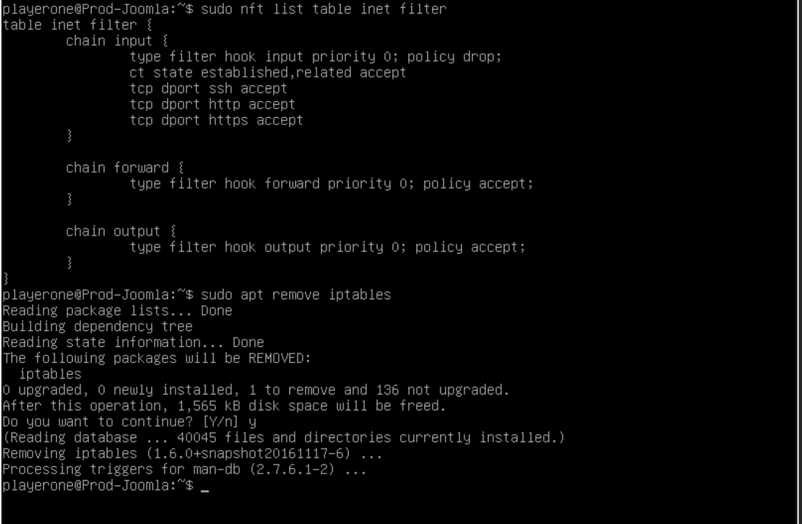

Next, I enabled the `nftables` service with `sudo systemctl enable nftables` and removed the old firewall package using `sudo apt remove iptables`. I verified its removal with `dpkg -l iptables`. During verification, I noticed that the `nftables` service was enabled but showed as inactive when I checked it with `systemctl`. I started the service manually and checked again, confirming that it reported `active (exited)` with a successful execution status. I also had to reboot the server before the remaining filtering validation check passed.

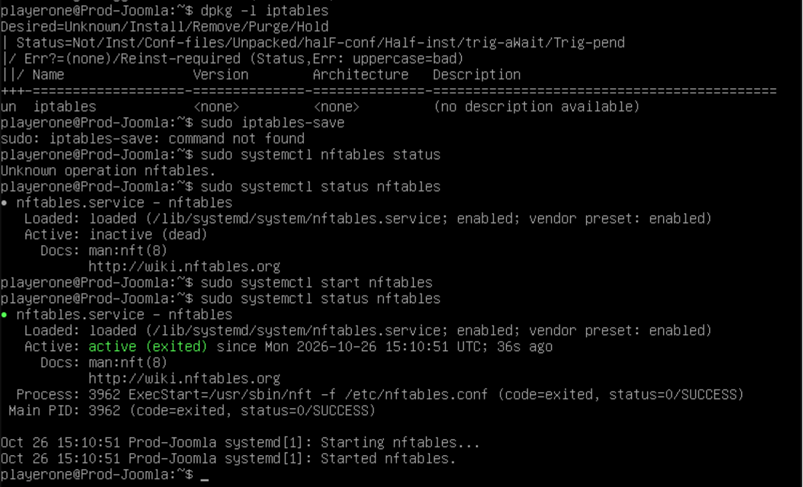

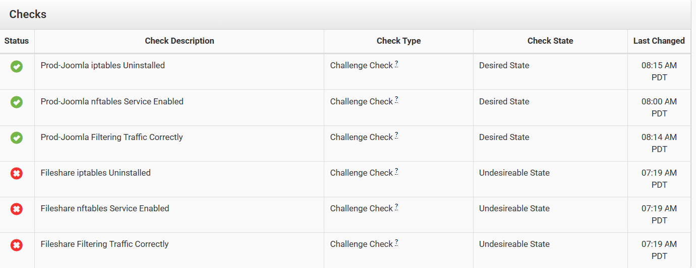

## Fileshare Firewall Migration

Once Prod-Joomla passed its three checks, I moved to the Fileshare server. I reviewed its saved rules using `cat fs_iptables_v4` and found that it also used a default DROP policy for incoming traffic. However, its allowed ports were different because the server needed SSH on TCP port 22, NetBIOS session service on TCP port 139, and SMB on TCP port 445.

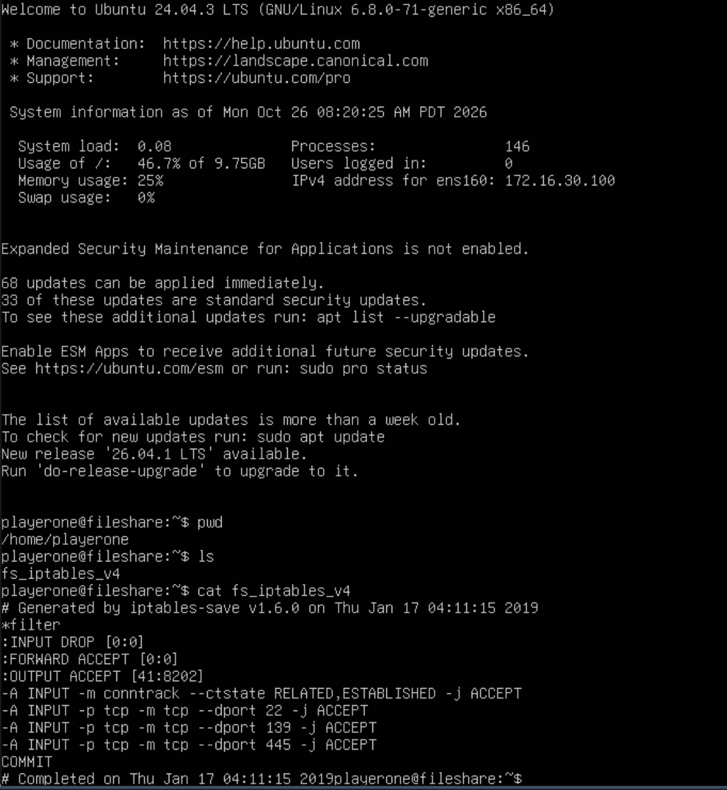

I confirmed that `nftables` was already installed by running `sudo apt install nftables`, then edited `/etc/nftables.conf` using GNU Nano. I recreated the existing firewall rules with an input policy of DROP, allowed established and related connections, and added the three required TCP ports. The forward and output chains retained their ACCEPT policies.

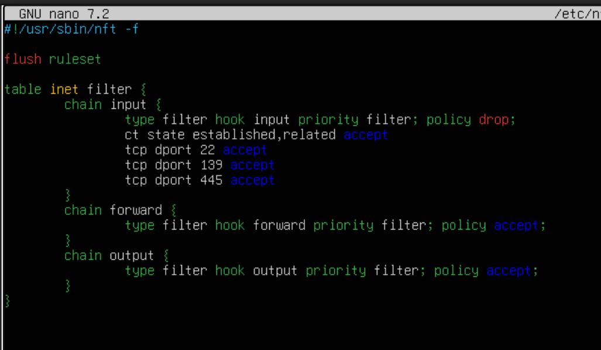

After saving the configuration, I enabled the `nftables` service, removed `iptables`, and started the new firewall service. I used `sudo nft list ruleset` to inspect the active configuration and confirm that all the required rules were present. This migration was more straightforward than Prod-Joomla because I did not encounter the same version compatibility or service activation issues.

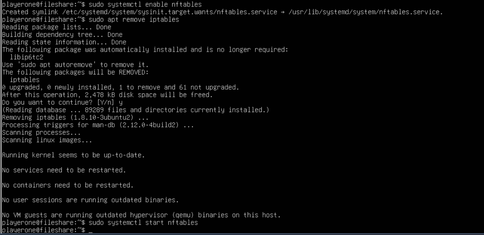

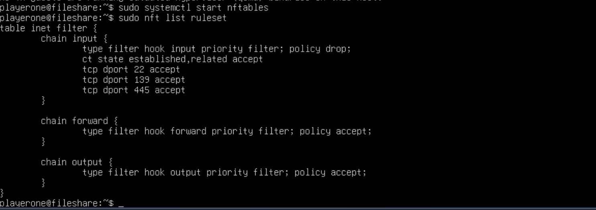

## Final Results and What I Learned

Both servers successfully passed all three checks, giving me a final result of **6/6**. The challenge took approximately 1 hour and 16 minutes to complete. I was able to migrate the existing firewall configurations, remove `iptables`, enable `nftables`, and preserve the required network access on both systems.

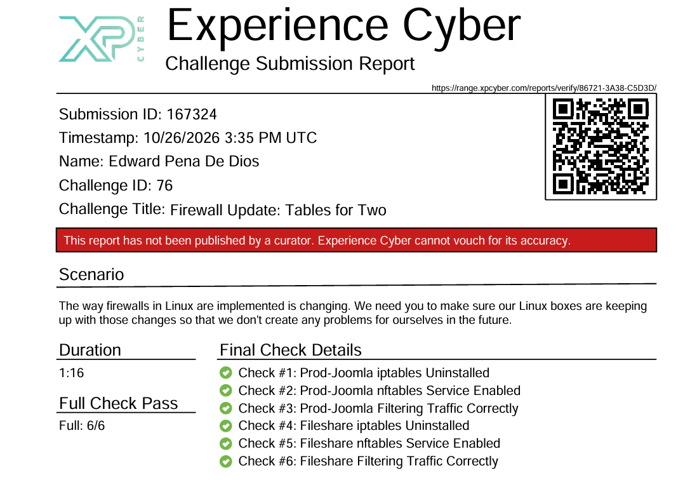

This challenge gave me much-needed hands-on experience configuring Linux firewalls through the terminal, since I was more familiar with using graphical interfaces in previous firewall labs. The most useful part was troubleshooting Prod-Joomla because I had to work around an older version of `nftables`, investigate why the service was inactive, and verify that the new rules were actually loaded. It reinforced the importance of checking the existing configuration before making changes and verifying the results instead of assuming that a command completed everything correctly.

## Documentation

The repository includes screenshots showing the original firewall rules, new configurations, troubleshooting steps, and final validation results. I also included the challenge submission report and my detailed lab report.

- [Detailed Lab Report](Documentation/XP_CyberRange4Report.pdf)
- [XP Cyber Range Submission Report](Documentation/EdwardPenaDeDios_NCPReport167324.pdf)

**Skills Practiced:** Linux administration, firewall configuration, network security, `iptables`, `nftables`, service management, troubleshooting, and technical documentation.

*Completed in a simulated XP Cyber Range environment. The challenge reported a full 6/6 check pass; the submission report has not been independently published by a curator.*
